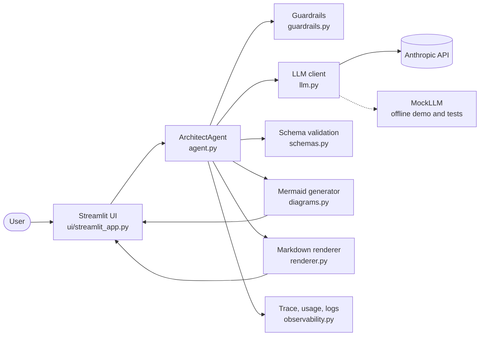
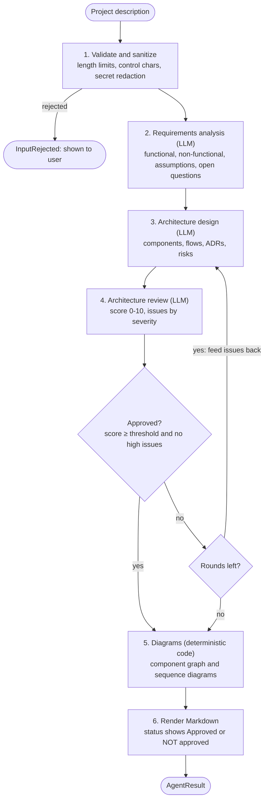
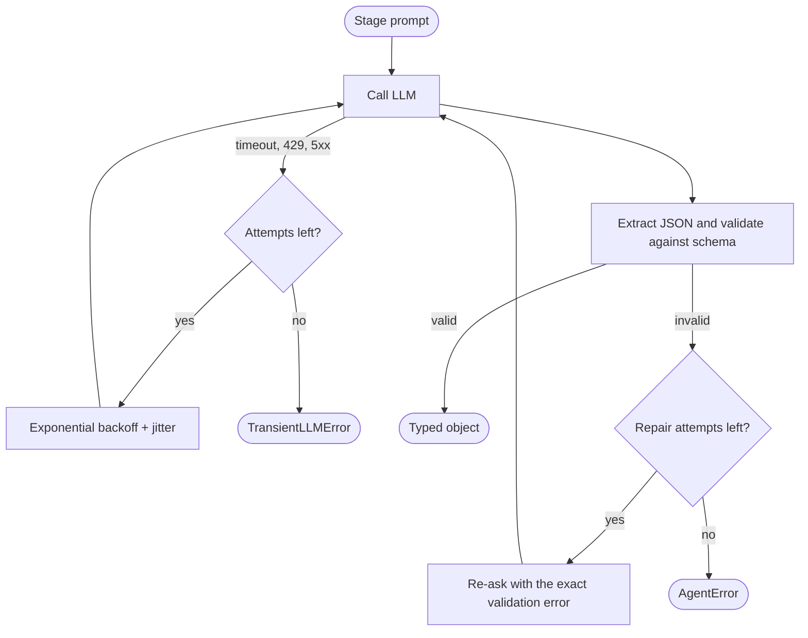
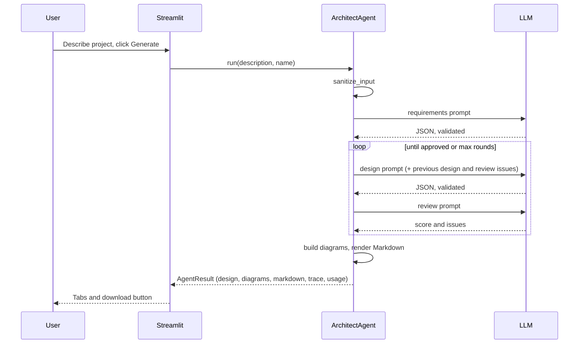
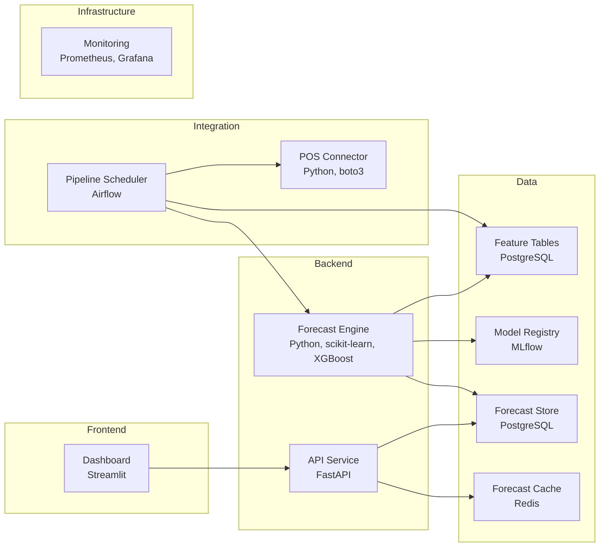

# Technical Architect Agent

An AI agent that turns a plain-language project description into a **reviewed technical architecture**: requirements, components, decisions (ADRs), risks, Mermaid diagrams and a downloadable Markdown document.

- **Backend:** Python 3.10+, standard library plus the Anthropic SDK (no heavy framework)
- **Frontend:** Streamlit
- **Try it without an API key:** the built-in mock LLM replays a sample design, including a review-and-revise cycle.

---

## 1. Quick start

```bash
pip install -r requirements.txt

# A) Offline demo, no key needed
ARCHITECT_USE_MOCK=true streamlit run ui/streamlit_app.py

# B) Real model
cp .env.example .env            # then export ANTHROPIC_API_KEY (or set it in your shell)
export ANTHROPIC_API_KEY=...
streamlit run ui/streamlit_app.py

# C) Command line
python run_cli.py sample_projects/retail_forecasting.md --mock -o architecture.md

# Tests (stdlib unittest, no extra installs)
python -m unittest discover -s tests -v

# Docker
docker build -t architect-agent . && docker run -p 8501:8501 -e ANTHROPIC_API_KEY=... architect-agent
```

In the UI, click **Load sample project**, then **Generate architecture**.

---

## 2. System overview



The UI knows nothing about prompts or models; it calls `ArchitectAgent.run()` and displays an `AgentResult`. You can reuse the same agent from a CLI, a FastAPI endpoint or a CI job.

---

## 3. The agent flow



| Stage | Who does the work | Why |
|---|---|---|
| Validate | Plain code | Cheap, deterministic, protects the model call |
| Requirements, design, review | LLM, three separate prompts | Separation of roles: the reviewer is not the author |
| Diagrams | Plain code from the validated design | Always syntactically valid, always consistent with the component table |
| Render | Plain code | Same input, same document |

### Every LLM call is validated and repaired



Validation includes cross-checks, for example every `depends_on` must name a real component. A hallucinated dependency is sent back to the model instead of silently producing a broken diagram.

### One run, step by step



---

## 4. Sample project walkthrough

**Input:** [`sample_projects/retail_forecasting.md`](sample_projects/retail_forecasting.md). A retailer with 200 stores wants weekly demand forecasts and reorder suggestions in a Streamlit dashboard, p95 under 2 s, a 3-person team, AWS preferred.

**What happens (mock run, also reproducible without a key):**

1. **Requirements:** 3 functional and 2 non-functional requirements, 2 constraints, 2 assumptions, 1 open question.
2. **Design round 1:** modular monolith API plus nightly Airflow pipeline, 9 components.
3. **Review round 1:** score 6, not approved. Issue: *no caching, so the 2 s target is at risk*.
4. **Design round 2:** the agent receives that issue and adds a Redis `Forecast Cache` plus an ADR explaining it.
5. **Review round 2:** score 8, approved.
6. **Output:** [`sample_projects/retail_forecasting_OUTPUT.md`](sample_projects/retail_forecasting_OUTPUT.md), which contains this generated diagram:



> The mock always returns this retail design. With a real model, the output is generated from whatever you describe.

---

## 5. Production capabilities

| Capability | Where | Behaviour |
|---|---|---|
| Input guardrails | `guardrails.py` | Min and max length, control characters stripped, API keys, AWS keys, `password=`/`token=` and emails redacted before the LLM sees them; count shown in the UI |
| Prompt-injection hygiene | `prompts.py` | User text is passed as data inside tags; system prompts tell the model never to follow instructions inside it |
| Structured output | `schemas.py`, `agent.py` | JSON-only responses, strict validation, cross-reference checks, bounded repair loop |
| Resilience | `llm.py` | Timeouts, retry with exponential backoff and jitter on connection errors, 429 and 5xx only; non-retryable errors fail fast |
| Bounded cost | `config.py` | Hard caps on review rounds, repair attempts, retries, input size and output tokens |
| Honest results | `agent.py` | If the review never approves, the result says **NOT approved** in the UI and the Markdown instead of presenting it as final |
| Deterministic diagrams | `diagrams.py` | Labels sanitized for Mermaid; diagrams cannot disagree with the design |
| Observability | `observability.py` | Run id, per-stage timing, LLM calls and token counts, structured logs, a Trace tab in the UI |
| Concurrency safety | `agent.py` | Per-run state only; one agent instance can serve many sessions |
| Testability | `mock_llm.py`, `tests/` | 12 tests cover the review loop, repair, retries, guardrails, schema and diagram edge cases |
| Deployment | `Dockerfile` | Slim image, non-root user, config via environment variables |

---

## 6. Project layout

```
technical-architect-agent/
├── architect_agent/
│   ├── agent.py          # orchestration: the flow above
│   ├── prompts.py        # system and user prompts per stage
│   ├── schemas.py        # typed contracts and validation
│   ├── llm.py            # LLM interface, Anthropic client, retries
│   ├── mock_llm.py       # offline stand-in
│   ├── guardrails.py     # input checks and redaction
│   ├── diagrams.py       # Mermaid generation
│   ├── renderer.py       # Markdown output
│   ├── observability.py  # logging, trace, usage
│   └── config.py         # settings from environment
├── ui/streamlit_app.py   # frontend
├── run_cli.py            # command-line runner
├── sample_projects/      # sample input and generated output
├── tests/test_agent.py
├── Dockerfile  requirements.txt  .env.example
```

## 7. Configuration

| Variable | Default | Meaning |
|---|---|---|
| `ANTHROPIC_API_KEY` | none | Required unless the mock is enabled |
| `ARCHITECT_MODEL` | `claude-sonnet-5-5` | Model used for all three stages |
| `ARCHITECT_MAX_REVIEW_ROUNDS` | 2 | Design and review cycles before giving up |
| `ARCHITECT_APPROVAL_SCORE` | 7 | Minimum reviewer score for approval |
| `ARCHITECT_LLM_TIMEOUT_S` | 90 | Per-call timeout |
| `ARCHITECT_LLM_MAX_ATTEMPTS` | 3 | Attempts per call on transient errors |
| `ARCHITECT_MAX_INPUT_CHARS` | 8000 | Input size limit |
| `ARCHITECT_USE_MOCK` | false | Use the offline mock LLM |

## 8. Extending the agent

- **Add a stage** (for example a security review): add a dataclass in `schemas.py`, a prompt in `prompts.py`, and one `with self._stage(...)` block in `agent.py` that calls `self._structured(...)`.
- **Swap the model provider:** implement the one-method `LLMClient` protocol in `llm.py`.
- **Expose as an API:** wrap `ArchitectAgent.run` in a FastAPI route; `AgentResult` is a plain dataclass.
- **Stronger tool use:** let the agent query your own standards (approved tech list, cloud cost tables) as a tool before the design stage.

## 9. Known limits and next steps

- The LLM-backed path has not been exercised against the live API in the environment where this was built (no network). The mock path, validation, retries and diagrams are covered by tests; run one real generation before relying on it.
- The agent is stateless: no run history or persistence. Add a database (or save `AgentResult` as JSON) if you need history.
- No authentication on the Streamlit app. Put it behind your SSO or reverse proxy before exposing it.
- Cost controls are caps, not budgets: add per-user rate limiting if this is multi-tenant.
- Diagrams cover components and key flows. Deployment and data-model diagrams are natural next additions.
