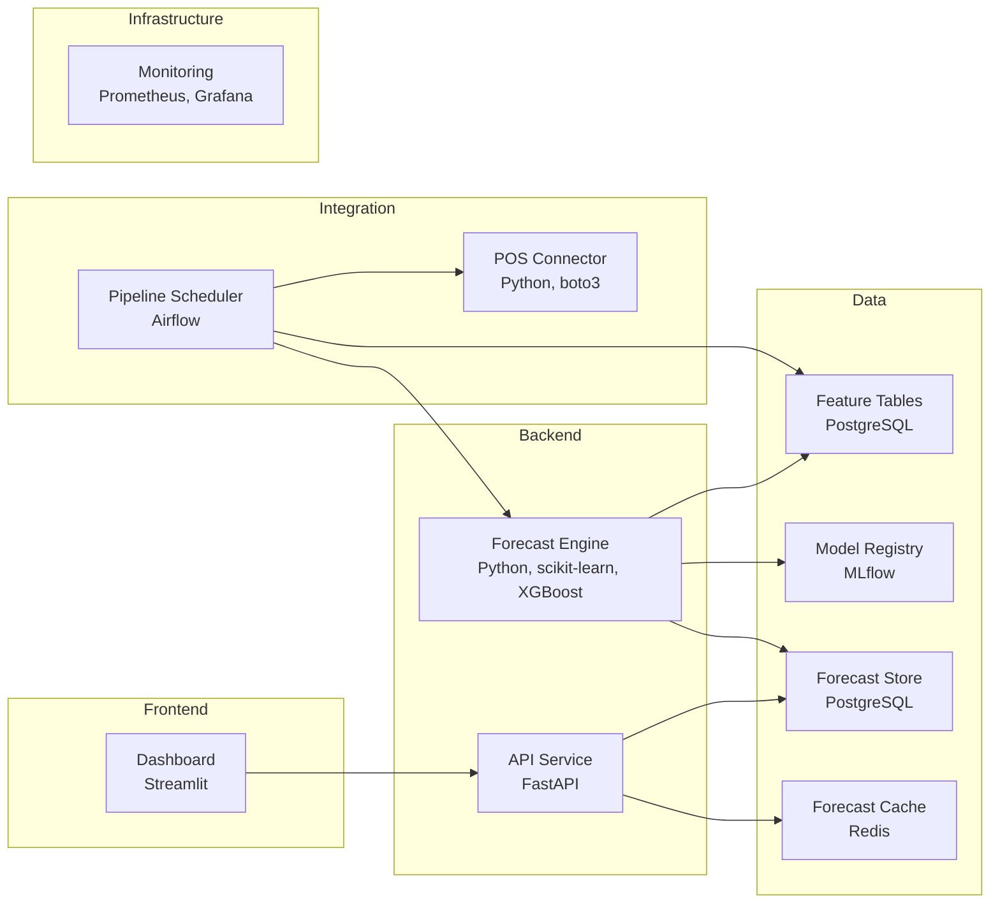
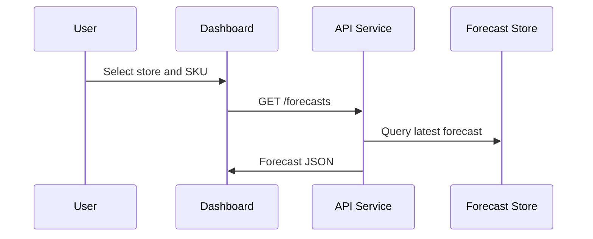
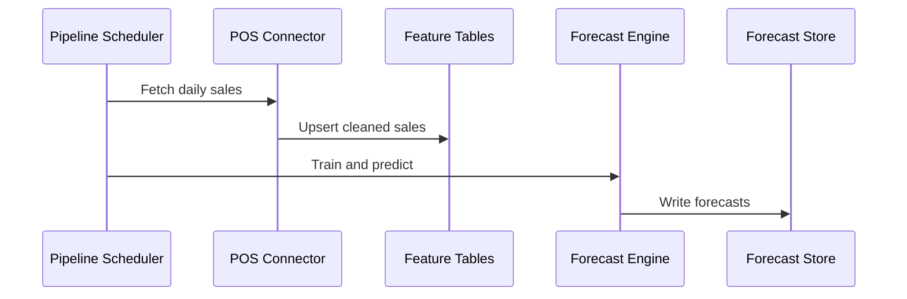

# Retail Forecasting: Technical Architecture

**Review status:** Approved (score 8/10 after 2 review round(s))

## 1. Summary
A web platform that forecasts weekly product demand per store and recommends reorder quantities.

## 2. Requirements

### Functional
| ID | Requirement | Priority |
|---|---|---|
| FR-1 | Ingest daily sales from store POS systems | must |
| FR-2 | Generate 4-week demand forecasts per SKU and store | must |
| FR-3 | Show forecasts and reorder suggestions in a dashboard | must |

### Non-functional
| ID | Requirement | Priority |
|---|---|---|
| NFR-1 | Dashboard p95 response under 2 s | must |
| NFR-2 | Nightly pipeline finishes within 2 hours | should |

### Constraints
- Python backend
- Streamlit frontend

### Assumptions
- About 200 stores and 20,000 SKUs
- POS exports are available as daily files or an API

### Open questions
- Is real-time inventory needed, or is daily sufficient?

## 3. Architecture (Modular monolith API plus scheduled batch pipeline)
A FastAPI service serves forecasts to a Streamlit dashboard. A nightly Airflow pipeline loads POS data into PostgreSQL, builds features, trains models and publishes forecasts.

| Component | Layer | Responsibility | Tech | Depends on |
|---|---|---|---|---|
| Dashboard | frontend | Forecast and reorder views | Streamlit | API Service |
| API Service | backend | AuthN/Z, forecast and inventory endpoints | FastAPI | Forecast Store, Forecast Cache |
| Forecast Engine | backend | Trains models and writes forecasts | Python, scikit-learn, XGBoost | Feature Tables, Model Registry, Forecast Store |
| POS Connector | integration | Pulls daily sales from POS exports | Python, boto3 | - |
| Pipeline Scheduler | integration | Orchestrates nightly ingest and training | Airflow | POS Connector, Feature Tables, Forecast Engine |
| Feature Tables | data | Cleaned sales and calendar features | PostgreSQL | - |
| Forecast Store | data | Published forecasts and reorder suggestions | PostgreSQL | - |
| Model Registry | data | Versioned model artifacts and metrics | MLflow | - |
| Monitoring | infra | Metrics, logs and alerts | Prometheus, Grafana | - |
| Forecast Cache | data | Read-through cache for hot forecasts | Redis | - |

## 4. Diagrams

### Component architecture

### Flow: View forecast

### Flow: Nightly pipeline

## 5. Deployment
- Docker images per service on a managed container platform
- Managed PostgreSQL with daily backups
- CI pipeline runs tests and builds images

## 6. Decisions (ADRs)

**ADR-1: Batch forecasting instead of streaming**
- Decision: Train and predict nightly
- Rationale: Reorders are planned daily; batch is simpler and cheaper
- Alternatives considered: Streaming with Kafka

**ADR-2: Add Redis read cache**
- Decision: Cache forecast reads for 15 minutes
- Rationale: Meets the 2 s p95 target under dashboard load
- Alternatives considered: Materialized views

## 7. Risks
| Risk | Mitigation |
|---|---|
| POS data arrives late or malformed | Schema validation, data-quality checks and alerts before training |

## 8. Review findings
| Severity | Issue | Suggestion |
|---|---|---|
| low | Define data retention for old forecasts | Archive forecasts older than 13 months |
