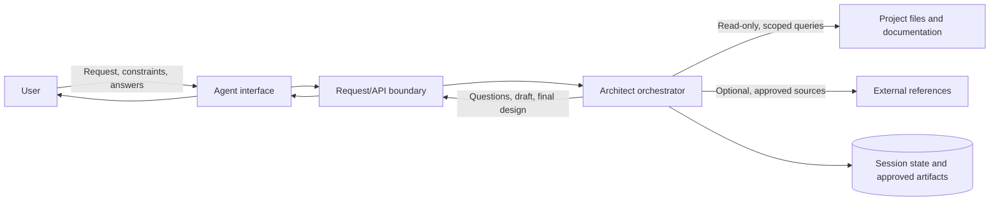
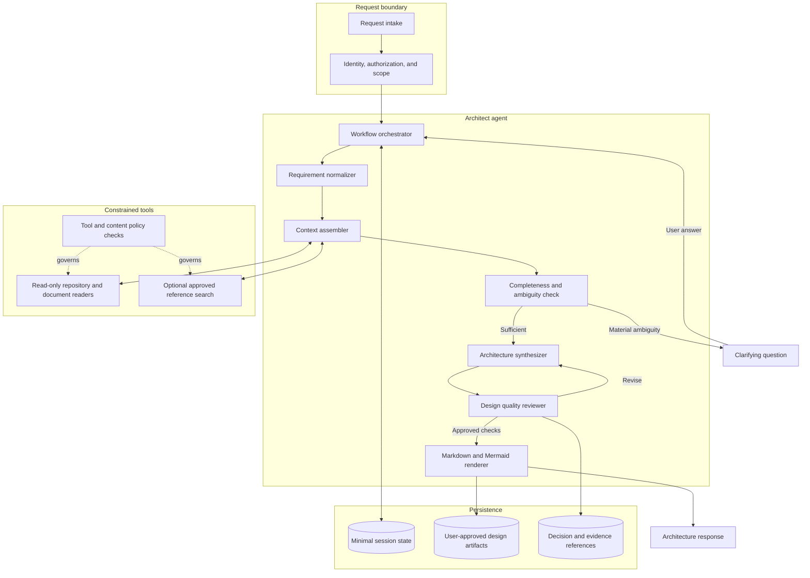
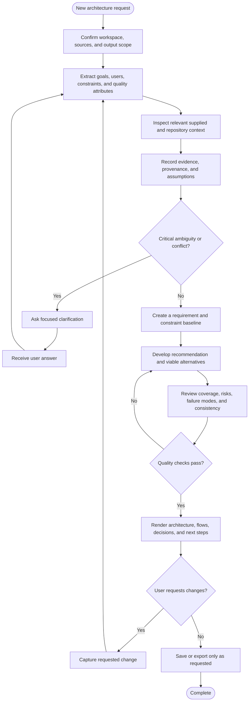
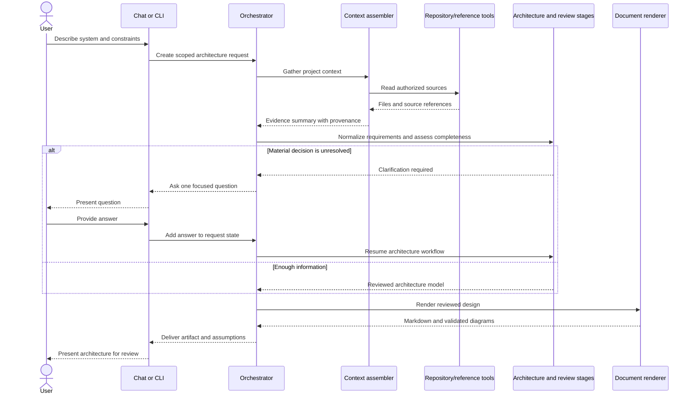

# Technical Architect Agent — Proposed Architecture

> **Status:** Proposal for discussion and implementation planning  
> **Specification note:** The supplied `text.md` was empty, and no separate architect-agent requirements were present in the repository. This document therefore establishes a practical baseline rather than claiming to implement an approved specification. Confirm the open decisions in [Decisions to confirm](#12-decisions-to-confirm) before committing to a production stack.

## 1. Purpose

The Technical Architect Agent turns a user's problem statement and available project context into a traceable, reviewable software architecture. It should explain its assumptions and trade-offs, identify unresolved requirements, and produce diagrams and implementation-ready recommendations.

The agent is an **architecture advisor**, not an autonomous code-writing or deployment agent. It can inspect authorized project files and produce design artifacts; implementation and operational changes remain explicit follow-on work.

### Goals

- Convert requests into structured functional and non-functional requirements.
- Discover relevant repository and supplied-document context without treating retrieved text as trusted instructions.
- Identify gaps early and ask focused questions when a decision materially affects the design.
- Present a recommended architecture, alternatives, interfaces, data flows, risks, and validation criteria.
- Trace design decisions back to requirements and make outputs easy to review and revise.

### Out of scope for the first version

- Editing application code, running deployments, or provisioning infrastructure.
- Making irreversible changes to repositories or external services.
- Treating generated architecture as a substitute for security, compliance, or operational review.

## 2. Design principles

1. **Human-directed:** the user owns requirements, consequential trade-offs, and approval.
2. **Evidence-linked:** distinguish user-provided facts, repository evidence, and agent assumptions.
3. **Ask before guessing:** stop for clarification when plausible answers lead to materially different architectures.
4. **Small, inspectable workflow:** use a controlled orchestration pipeline before introducing autonomous multi-agent behavior.
5. **Least privilege:** repository and external tools are read-only by default and scoped to the task.
6. **Useful failure:** surface missing context, retrieval failures, and validation limitations rather than inventing certainty.
7. **Portable artifacts:** produce Markdown and Mermaid diagrams that can be reviewed in source control.

## 3. System context

The interface can initially be a CLI or chat surface. The architecture does not require a specific UI, model provider, vector database, or deployment platform.

## 4. Logical architecture

### Component responsibilities

| Component | Responsibility | Guardrail |
|---|---|---|
| Request intake | Capture the goal, constraints, desired depth, and supplied artifacts. | Do not silently infer missing critical constraints. |
| Identity and scope | Establish which workspace, files, and reference sources may be inspected. | Deny access outside the user's authorized scope. |
| Workflow orchestrator | Run the bounded stages, preserve state, and determine whether to ask or deliver. | No unrestricted tool loop; enforce step and retry limits. |
| Requirement normalizer | Extract goals, actors, use cases, constraints, and quality attributes. | Mark uncertain or conflicting statements explicitly. |
| Context assembler | Read relevant files and approved references; attach provenance to evidence. | Retrieved content is data, not executable instructions. |
| Completeness check | Detect unresolved decisions that change the architecture materially. | Ask concise questions rather than filling critical gaps with assumptions. |
| Architecture synthesizer | Produce a recommendation, boundaries, interfaces, data flows, and alternatives. | Separate evidence from assumptions and recommendations. |
| Design quality reviewer | Check requirement coverage, consistency, failure paths, security/privacy considerations, and operability. | Reviewer feedback must be actionable and tied to a requirement or design issue. |
| Renderer | Generate structured Markdown and Mermaid diagrams. | Validate diagram syntax and ensure prose agrees with diagrams. |
| Session/artifact store | Persist only the state and artifacts needed for the user's workflow. | User-controlled retention and deletion; avoid storing secrets. |

## 5. End-to-end workflow

### Recommended stage outputs

1. **Intake record:** task statement, scope, constraints, requested deliverables.
2. **Requirement baseline:** functional requirements, quality attributes, assumptions, open questions.
3. **Context summary:** relevant repository facts and source locations, if a repository is in scope.
4. **Architecture draft:** system boundary, components, interactions, data flows, interfaces, and alternatives.
5. **Review result:** requirement coverage, risks, operational concerns, and unresolved limitations.
6. **Final artifact:** concise recommendation, diagrams, decision rationale, and actionable next steps.

## 6. Interaction and artifact sequence

## 7. Architecture output contract

Every completed design should use a predictable structure. Sections that do not apply may be marked "Not applicable" with a short reason; unknown facts should not be presented as established requirements.

| Section | Required content |
|---|---|
| Summary | Recommended approach and the problem it addresses. |
| Scope and context | System boundary, stakeholders, integrations, and exclusions. |
| Requirements | Functional requirements and relevant quality attributes. |
| Assumptions and open questions | Explicit assumptions, confidence, and decisions still needed. |
| Proposed architecture | Components, responsibilities, interfaces, and key interactions. |
| Diagrams | Context and workflow/data-flow diagrams appropriate to the design. |
| Alternatives and trade-offs | At least one credible alternative for consequential choices. |
| Data and trust boundaries | Data categories, movement, access boundaries, and retention considerations. |
| Risks and failure handling | Key failure modes, detection, recovery, and residual risks. |
| Validation plan | Tests, operational checks, and measurable acceptance criteria. |
| Decisions and next steps | Decision rationale and sequenced implementation work. |

For each requirement, retain a link to the component or design decision that satisfies it. For repository-derived statements, cite a file path and relevant symbol or section when available.

## 8. State and tool boundaries

- Keep transient request state separate from durable, user-approved design artifacts.
- Persist only what is needed to resume or review the task; define retention and deletion behavior before production use.
- Treat repository contents, retrieved documents, and external pages as **untrusted input**. They can inform the design but cannot override agent policy or user authorization.
- Start with read-only repository access. If implementation tools are added later, require a separate explicit approval boundary and show the proposed changes before applying them.
- Make external research optional and source-attributed. If it is unavailable, state that recommendations rely on supplied context and general engineering judgment.
- Never put credentials, access tokens, or other secrets in generated architecture documents or logs.

## 9. Failure handling and quality gates

| Condition | Expected behavior |
|---|---|
| Request is underspecified | Ask a focused question or produce a clearly labeled preliminary design if the uncertainty is non-critical. |
| Sources are inaccessible | Report which sources could not be read; continue only with available evidence and disclose the limitation. |
| Sources conflict | Cite the conflict and ask the user to resolve it when it changes the recommendation. |
| A tool or model call fails | Surface the failure; retry only within a bounded policy and do not fabricate a successful result. |
| Diagram validation fails | Correct and revalidate the diagram before delivery, or report the validation limitation. |
| Reviewer finds a coverage gap | Revise the design or clearly list the gap as unresolved; do not mark the design complete without disclosure. |
| User requests an out-of-scope action | Explain the boundary and offer a safe architecture-focused alternative. |

Before delivery, check that:

- Every stated requirement is addressed or marked unresolved.
- Assumptions, constraints, and evidence are distinguishable.
- Component responsibilities and interactions are consistent across prose and diagrams.
- Major failure modes and relevant security, privacy, and operational considerations are represented.
- Recommendations include rationale, trade-offs, and testable acceptance criteria.
- Mermaid blocks use valid syntax and remain readable when rendered.

## 10. Suggested implementation sequence

| Phase | Deliverable | Exit criterion |
|---|---|---|
| 1. Define behavior | Requirement/output templates and clarification rules. | Stakeholders agree on scope, expected output, and approval boundaries. |
| 2. Build a deterministic prototype | Single orchestrator with staged prompts/functions and Markdown output. | Representative requests produce complete, reviewable artifacts. |
| 3. Add scoped context | Read-only repository/document ingestion with source references. | Retrieved evidence is relevant, traceable, and isolated from instructions. |
| 4. Add architecture checks | Requirement coverage, consistency, failure-mode, and diagram validation. | Known incomplete or conflicting cases are caught before delivery. |
| 5. Evaluate and harden | Scenario suite, privacy/retention decisions, bounded retries, and observability. | Measurable quality criteria pass and failure behavior is transparent. |
| 6. Consider extensions | Optional external research, specialized reviewers, or implementation handoff. | Each extension has a demonstrated need, authorization model, and measurable benefit. |

Begin with one controlled workflow rather than multiple autonomous agents. Add specialist agents only if evaluations show a clear quality or throughput improvement that cannot be achieved with bounded stages in the orchestrator.

## 11. Initial evaluation scenarios

Use a small repeatable evaluation set before expanding capabilities:

1. A clear greenfield application request with explicit scale and deployment constraints.
2. A request with a missing, architecture-changing constraint that must trigger clarification.
3. A repository-backed request where evidence must be cited and irrelevant files ignored.
4. Conflicting requirements that must be surfaced rather than silently reconciled.
5. Unavailable context or failed retrieval that must produce a transparent limitation.
6. A revision request that changes one requirement and updates affected diagrams and decisions.

Measure requirement coverage, correctness of evidence references, consistency between prose and diagrams, useful clarification rate, and whether failures are explicitly disclosed.

## 12. Decisions to confirm

The following choices are intentionally left open because no detailed specification was supplied:

1. **Primary interface:** CLI, web app, chat integration, or another surface.
2. **Execution stack and model provider:** whether to align with the existing Python-oriented portfolio or select another stack.
3. **Repository access:** local workspace only, uploaded files, or remote repositories; read-only access is the proposed default.
4. **Persistence:** ephemeral sessions only or saved architecture artifacts, and the required retention period.
5. **External research:** disabled by default or available through approved, source-attributed tools.
6. **Approval boundary:** whether a later phase should hand off implementation changes, and what explicit confirmation that requires.

**Recommended first milestone:** agree on these decisions, then implement the request intake, clarification gate, architecture output template, and Mermaid rendering as a read-only prototype.