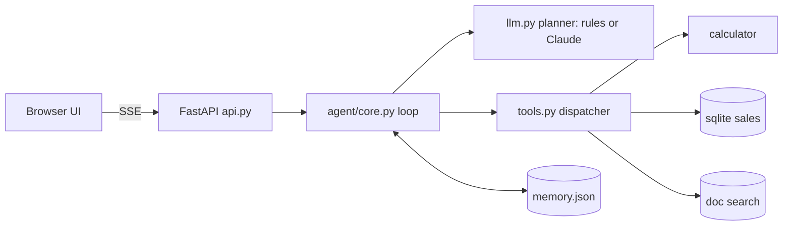
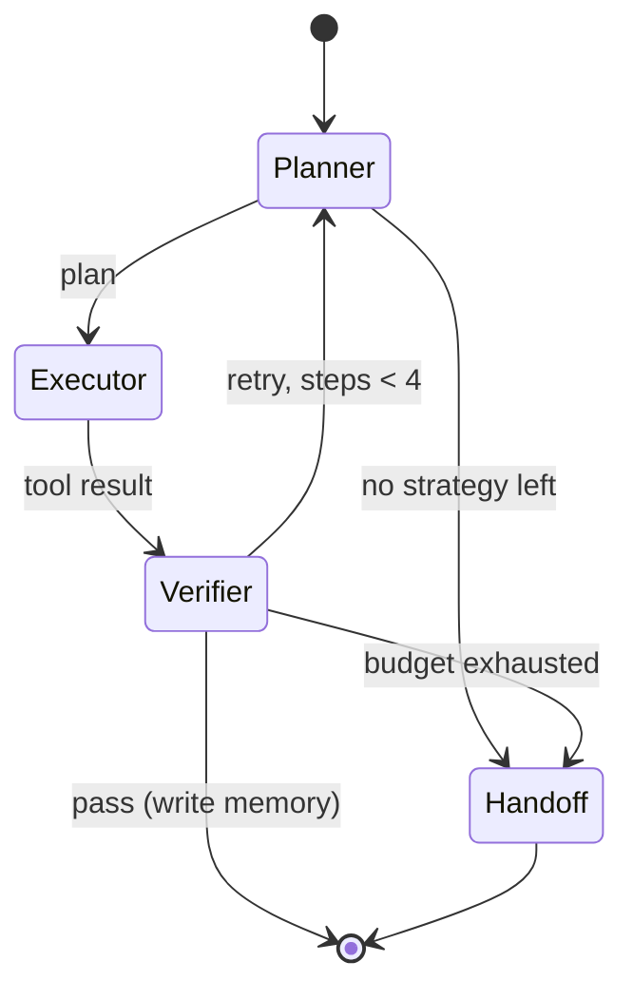

# Architecture

## Design decisions
- **Verifier gates exit and memory writes.** The executor cannot declare success.
- **Errors are data.** The dispatcher returns `{ok, error}`; the planner reroutes around failed tools.
- **Retries only for transient errors.** Deterministic errors (bad args, no docs) fail fast.
- **Retrieved text is untrusted.** Injection-like sentences are stripped before they reach the answer.
- **Hard step budget (4).** Prevents runaway loops; exhaustion triggers human handoff.

## Known limitations
Single-tool plans only; keyword search stands in for vector/graph retrieval; no auth beyond an optional API key; memory is a local JSON file.
